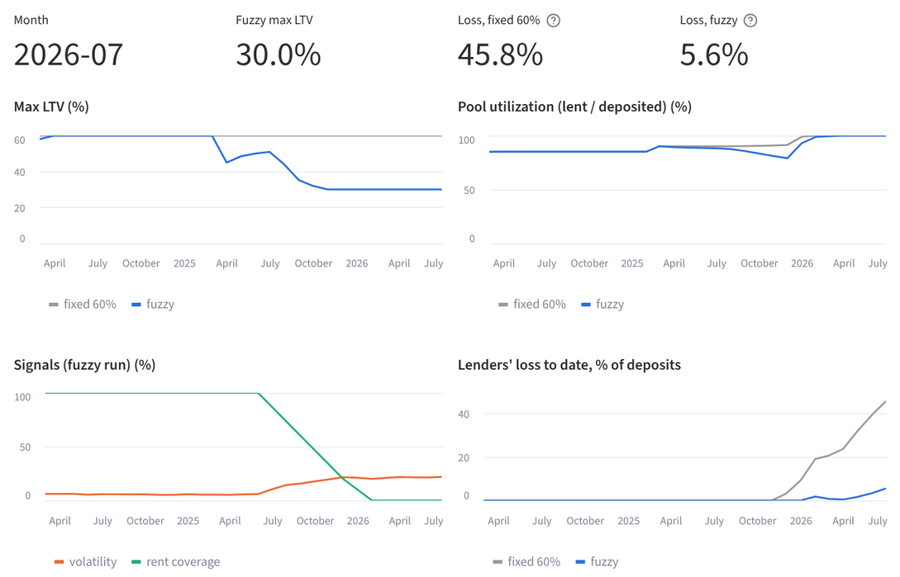
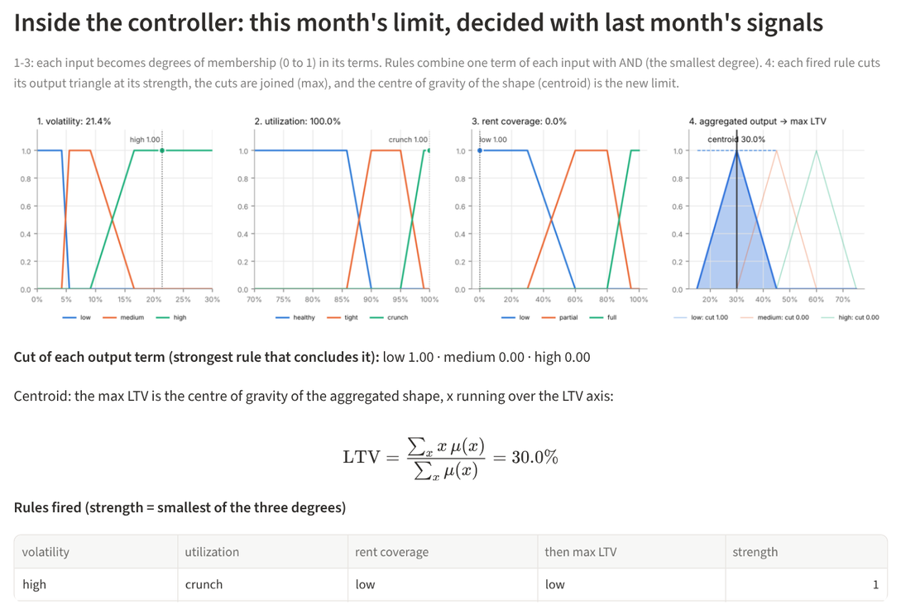

# Adaptive LTV for tokenized real estate

[](https://github.com/ChristopheAbelem/adaptive-ltv-rwa/actions/workflows/tests.yml)

**Can a lending pool backed by tokenized houses avoid RealT's losses by adjusting its maximum loan-to-value (LTV)
every month instead of keeping it fixed at 60%?** In a simulation of RealT's 2024-2026 collapse, a fuzzy controller
that reads price volatility, pool liquidity and rent payments cuts lenders' losses from about 46% to about 6% of
deposits, provided borrowers repay part of their loans when the limit falls. Against a pure house-price crash, a fixed
60% already loses little and the controller is not reliably better.



## The problem

RealT sold fractions of rented Detroit houses as tokens and ran a lending market (RMM) where those tokens served as
collateral, with a fixed max LTV of 60% and liquidation at 70%. In 2025-2026 rent stopped reaching token holders,
the tokens lost most of their value while house prices and appraisals stayed high, lenders ran, and the pool was
left with debt its collateral could not cover. A fixed limit cannot react to any of that.

## How it works

1. **Inputs** (monthly): de-smoothed volatility of the collateral price (Geltner on the Case-Shiller Detroit index),
   pool utilization (DefiLlama, RealT RMM) and rent coverage.
2. **Controller**: Mamdani fuzzy inference with 27 rules built from severity scores; output max LTV between 30% and
   60%. Every step (fuzzification, rule strengths, aggregation, centroid) is exposed and drawn.
3. **Environment**: 200 borrowers, interest paid from rent, a lender run when rent fails, liquidations at 70% of an
   appraisal refreshed yearly, forced-sale price impact. The controller's decision changes utilization and the
   collateral's market price, which feed the next month's inputs (closed loop).
4. **Scenarios**: operational collapse (RealT, Feb 2024 to Jul 2026), market shock (Detroit, 2006-2012) and 300
   Merton jump-diffusion futures; every assumption without public data is varied in a sensitivity analysis.



## Results

| Test | Fixed 60% | Fuzzy |
| --- | --- | --- |
| Operational collapse, lenders' loss (% of deposits) | 45.8% | 5.6% |
| Same, 20 random borrower books (mean) | 44.5% | 5.7% |
| Same, borrowers repay nothing when the limit falls | 47.0% | 47.0% |
| Same, token discount without rent 40% / 80% (base 60%) | 13.1% / 83.4% | 0.0% / 43.8% |
| Market shock, base case | 2.8% | 0.0% (sign changes with the assumptions) |
| 300 Merton futures, share with a loss above 1% | 2% | 0% |

**Limitations.** Rent coverage and appraisal dates are stylized from documented events (no public time series);
borrower repayment, the token discount and price impact have no public data; in the collapse the volatility input
partly repeats the rent signal. Details in the report notebook, sections 6 and 8, and in the [short report](docs/report.md).

## Run

```bash
uv venv --python 3.12 && source .venv/bin/activate
uv pip install -e ".[dev]"
pytest                      # 45 tests; the Case-Shiller series is downloaded from FRED on first use
streamlit run app.py        # real-time closed loop and the controller's internal steps
python -m adaptive_ltv collapse   # same comparison in the terminal
```

The report is `01_adaptive_ltv.ipynb` (run top to bottom); `00_data_test.ipynb` documents how every input was
obtained and checked.

## Structure

| Path | Content |
| --- | --- |
| `adaptive_ltv/inputs.py` | Input signals: de-smoothed Detroit volatility, pool utilization, stylized rent coverage |
| `adaptive_ltv/membership.py` | Fuzzy variables and membership functions |
| `adaptive_ltv/controller.py` | 27-rule Mamdani controller (severity scoring), exposes every inference step |
| `adaptive_ltv/analysis.py` | Static test cases, control surfaces, fired-rule table |
| `adaptive_ltv/environment.py` | Monthly lending-pool environment, `update_market(state, max_ltv)`, closed-loop `run` |
| `adaptive_ltv/scenarios.py` | Market shock, operational collapse, Merton random futures |
| `adaptive_ltv/merton.py` | Merton jump-diffusion: calibration, simulation, closed forms |
| `adaptive_ltv/plots.py` | Chart helpers, including the four inference steps of one decision |
| `adaptive_ltv/live.py` | Real-time display inside the notebook |
| `adaptive_ltv/__main__.py` | Command line: prints each month as it runs |
| `app.py` | Streamlit app: closed loop in real time and the controller's internal steps |
| `scripts/make_report_figures.py` | Regenerates the figures of `docs/report.md` |
| `tests/` | `pytest` suite: de-smoothing, coverage, rules, monotonicity, environment accounting, Merton closed forms |
| `00_data_test.ipynb` | Data feasibility test: every input downloaded and checked, pass/fail per source |
| `01_adaptive_ltv.ipynb` | Report: modelling, rules, surfaces, environment, closed-loop results, sensitivity |

## Data

| Input | Source | Status |
| --- | --- | --- |
| Detroit house prices | FRED `DEXRNSA` (S&P Cotality Case-Shiller), downloaded at runtime and cut at Jul 2026, not redistributed | real |
| Pool utilization, lender flows | DefiLlama, RealT RMM | real |
| Risk parameters, liquidations | RMM v3 contracts on Gnosis Chain (public RPC) | real |
| Rent coverage, appraisal steps | Stylized from documented dates (no public time series) | stylized |
