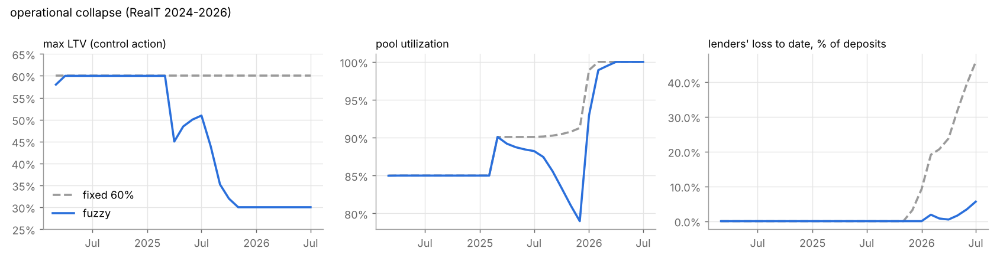
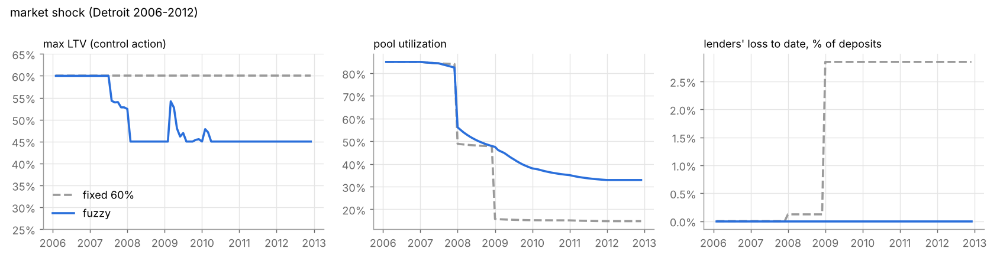

# Adaptive LTV for tokenized real estate: lessons from RealT

*Christophe Abelem — November 2026 — code and full analysis: [github.com/ChristopheAbelem/adaptive-ltv-rwa](https://github.com/ChristopheAbelem/adaptive-ltv-rwa)*

## Summary

- **Question.** Could a lending pool backed by tokenized houses have avoided most of RealT's losses by adjusting its
  maximum loan-to-value (LTV) every month instead of keeping it fixed at 60%?
- **Answer.** In a simulation of the 2024-2026 collapse, a fuzzy controller reading price volatility, pool liquidity
  and rent payments cuts lenders' losses from **45.8% to 5.6% of deposits** (20 random loan books: 44.5% vs 5.7%).
- **Condition.** The gain exists only if borrowers repay part of their loans when the limit falls. With no
  repayment, both rules lose 47%.
- **Where it does not help.** Against a pure house-price crash (Detroit 2006-2012), a fixed 60% already loses little
  (2.8%) and the controller's advantage changes sign with the assumptions.
- **Implication.** For real-world-asset collateral, the risk that matters is operational (income and liquidity), not
  only price. Risk parameters should read operational signals.

## 1. The case

RealT, the largest tokenized real estate platform (about 700 Detroit properties), sold fractions of rented houses as
tokens that pay a share of the rent. Holders could deposit the tokens in RealT's lending market (RMM) and borrow
stablecoins against them, with a fixed **max LTV of 60%** (a token worth $100 allows a $60 loan) and liquidation
when the loan reaches 70% of the collateral's appraised value.

From July 2025 rent was redirected to escrow by court order; distributions were largely halted by the end of 2025 and
formally suspended in February 2026. Tokens traded at deep discounts, yet Detroit house prices stayed
near their all-time high and the pool's appraisals did not move. Lenders withdrew, the pool's cash ran out in
January 2026, and liquidations sold collateral far below its appraisal. RealT announced its liquidation in July 2026.

A fixed limit cannot react to any of this, and a limit driven only by house prices would not have reacted either:
prices never fell.

## 2. Method

**Controller.** A Mamdani fuzzy controller sets the max LTV between 30% and 60% each month from three inputs:

| Input | Source | Terms |
| --- | --- | --- |
| Volatility of the collateral price | Case-Shiller Detroit index, seasonally adjusted and de-smoothed (Geltner, rho = 0.725), 12-month rolling | low / medium / high (historical percentiles) |
| Pool utilization (lent / deposited) | DefiLlama, RealT RMM, 2024-2026 | healthy / tight / crunch |
| Rent coverage (share of rent paid) | Stylized path between documented dates | full / partial / low |

The 27 rules are built from severity scores (volatility 0-2, utilization 0-4, rent 0-4), so that a liquidity crunch
or failed rent alone sets the 30% floor, while price volatility alone lowers the limit to 45%. A calm month gives
exactly 60%, the same as RealT's rule.

**Environment.** A monthly simulation of the pool with 200 borrowers: borrowers adjust their loans to the limit
(repaying 10% of any excess per month), pay interest out of rent, lenders run when rent fails (17% of deposits per
month, the largest fall observed on-chain), positions above 70% of a yearly appraisal are liquidated, and forced sales
lower the sale price. The loop is closed: the limit changes utilization and the collateral's market price, which feed
the next month's inputs. The simulated utilization matches the real pool to within 3 points on average.

**Validation.** 45 automated tests (de-smoothing, rule coverage, monotonicity of the controller, accounting
identities of the pool). For random futures, a Merton jump-diffusion calibrated on Detroit returns reproduces its
closed-form growth and variance within 0.2%.

## 3. Results

**Operational collapse (RealT, Feb 2024 - Jul 2026).** The controller keeps 60% until early 2025, then lowers the
limit as utilization and rent deteriorate, reaching the 30% floor in November 2025, two months before the pool runs
out of cash. Borrowers shrink their loans in the meantime, so when the pool empties the remaining positions are small.

| | Fixed 60% | Fuzzy |
| --- | --- | --- |
| Liquidations | 63 | 0 |
| Realized bad debt | 22.7% | 0.0% |
| Debt not covered by collateral at the end | 23.1% | 5.6% |
| **Total loss (% of deposits)** | **45.8%** | **5.6%** |

**Market shock (Detroit, 2006-2012).** House prices fall by half while rent keeps being paid. Both rules lose little;
the controller lowers the limit to 45% and avoids a 2.8% loss in the base case, but the comparison reverses with an
appraisal every 6 months or faster repayment.

**Random futures.** Over 300 simulated 7-year Detroit price paths with rent paid throughout, the fixed rule loses
more than 1% of deposits in 2% of them (worst case 4.9%), the controller in none.

## 4. How robust is it?

| Change (operational collapse) | Fixed 60% | Fuzzy |
| --- | --- | --- |
| Base case | 45.8% | 5.6% |
| Borrowers repay 0% / 5% / 15% of the excess per month | 47.0 / 46.5 / 45.4% | 47.0 / 22.4 / 0.0% |
| Token discount without rent 40% / 80% (base 60%) | 13.1 / 83.4% | 0.0 / 43.8% |
| Forced-sale price impact 0 / 0.75 (base 0.5) | 44.5 / 46.4% | 5.6 / 5.6% |
| Appraisal every 6 / 24 months (base 12) | 45.7 / 39.7% | 5.7 / 5.3% |
| Controller reads data volatility instead of simulated | 45.8% | 6.1% |

The direction holds in every case; the size depends on two behaviours without public data: how fast borrowers repay
when the limit falls, and how much a token loses when rent stops.

## 5. Limitations

- **Stylized rent.** No public rent series exists; its timing is set from press-documented dates. The study shows how
  the controller reacts when rent falls, not that rent data would have warned in time.
- **Behavioural assumptions.** Repayment speed, token discount and price impact are assumptions, tested above.
- **Overlapping signals.** In the collapse the token's price falls because rent falls, so volatility partly repeats
  the rent signal.
- **Simplifications.** One pool, monthly steps, identical collateral units; real pools react daily.

## 6. Implications

1. **Collateral backed by real-world income needs operational risk inputs.** Price-based risk parameters, the
   standard in DeFi lending, would have seen nothing in RealT's case.
2. **A lower limit protects lenders only if existing loans shrink.** Lending protocols that lower LTV usually apply it
   to new loans only; a gradual repayment rule is what turns the signal into protection.
3. **Fuzzy rules suit this job.** Risk teams already state their policy in words; a fuzzy controller makes those words
   executable, auditable, and gradual instead of threshold-driven.
